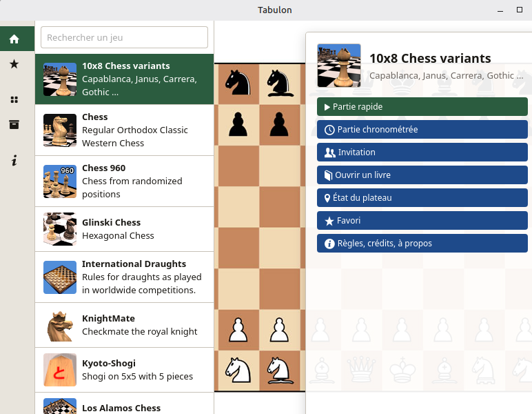
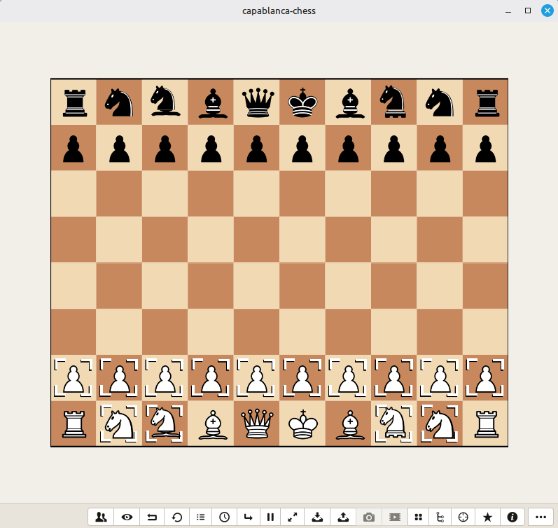
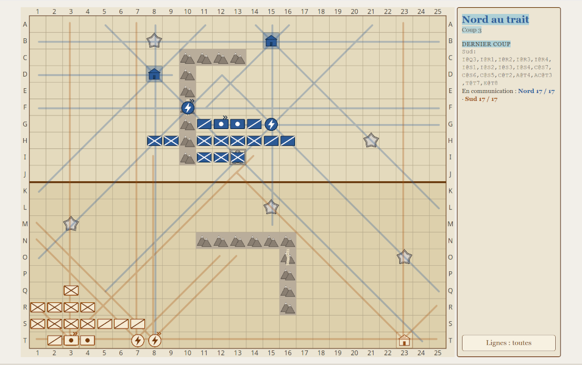

# Tabulon

*[English version](README.md)*

Tabulon est une application libre et multiplateforme (Linux, Windows, macOS) pour jouer à 130 jeux de plateau sur votre ordinateur : les échecs et leurs variantes, les dames, le shogi, le xiangqi, des jeux de territoire de type go, les jeux de moulin, le tafl, et bien d'autres.

Construit sur la bibliothèque de jeux Jocly avec Tauri 2, Tabulon s'inspire de JoclyBoard, aujourd'hui disparu.

## Ce que vous pouvez faire

- **Jouer en 2D ou en 3D** — chaque jeu propose plusieurs vues, avec des plateaux 3D que l'on peut faire pivoter et zoomer.
- **Jouer contre l'ordinateur** — plusieurs niveaux d'IA par jeu, ou regarder deux IA s'affronter.
- **Jouer contre un ami** — sur la même machine, ou **en ligne** (voir plus bas).
- **Apprendre en jouant** — chaque jeu est livré avec sa propre page de règles illustrée (en anglais ou en français selon les disponibilités).
- **Prendre son temps, ou jouer à la pendule** — pendules configurables, historique des coups avec reprise et rejeu, et retour à n'importe quelle position antérieure.
- **Sauvegarder et reprendre** — enregistrer les parties dans des fichiers, les recharger plus tard, garder ses positions de départ préférées comme modèles, et marquer ses jeux favoris pour y accéder rapidement.
- **Garder une trace de ses parties** — enregistrer une vidéo du plateau ou prendre des captures 3D, directement depuis l'application.
- **Ouvrir autant de plateaux que vous voulez** — chaque jeu s'ouvre dans sa propre fenêtre ; les fenêtres satellites (historique, pendule, joueurs, coups possibles…) suivent celle où vous jouez et se ferment avec elle. Dans une partie à la pendule, la pendule s'ouvre d'elle-même, à côté du plateau.
- **L'utiliser en anglais ou en français** — l'interface suit la langue de votre système.

## Exemples

|  |  |
|:---:|:---:|
| *Rococo* | *Le jeu de la guerre (Guy Debord)* |

## Pour commencer

**Des versions précompilées et prêtes à l'emploi de Tabulon sont disponibles pour Windows, Linux (x64 et ARM64) et macOS** sur la [page des versions](https://github.com/fhoudebert/tabulon/releases). Téléchargez le paquet correspondant à votre plateforme, installez-le (ou décompressez-le) et lancez-le : Tabulon fonctionne immédiatement avec une sélection de départ de jeux intégrés. (Vous préférez compiler depuis les sources ? Voir [DEVELOPMENT.md](DEVELOPMENT.md), en anglais.)

Sous Linux, deux AppImages ne demandent aucune installation : **`Tabulon-selection`** contient environ trente-cinq jeux prêts à jouer (échecs et variantes, shogi, xiangqi, dames, go 9×9, reversi, tafl…), **`Tabulon-minimal`** est la petite version, à compléter avec la bibliothèque complète ou des extensions. Rendez le fichier exécutable (`chmod +x Tabulon-selection-*.AppImage`) et lancez-le. Les deux se mettent à jour vers la dernière version avec [AppImageUpdate](https://github.com/AppImageCommunity/AppImageUpdate), en ne téléchargeant que ce qui a changé. Elles fonctionnent sous Ubuntu 22.04 et suivantes, et sur les distributions de la même époque (glibc 2.35).

Ces versions précompilées ne sont pas figées : la bibliothèque de jeux de n'importe quel Tabulon installé peut être **personnalisée** — jusqu'à la **bibliothèque complète de 130 jeux** — de deux façons :

1. **Installer des extensions (ajouter ou retirer des jeux)** — la méthode la plus simple. Ouvrez l'écran **Extensions** (barre latérale de l'accueil, groupe Configuration) et importez des fichiers `.tabulon-ext` téléchargés. Parcourez le catalogue :

   - [Modules](https://fhoudebert.github.io/tabulon/ext/modules/index.html) — des familles de jeux complètes, avec leurs ressources partagées.
   - [Jeux](https://fhoudebert.github.io/tabulon/ext/games/index.html) — des jeux individuels ; le module correspondant doit déjà être installé.

   Le lien « Obtenir des extensions… » de l'écran Extensions y mène directement. Les extensions peuvent aussi être **désinstallées** depuis ce même écran : vous pouvez ajouter et retirer des jeux à tout moment.

   **N'installez que des extensions de confiance** — celles du catalogue ci-dessus, ou venant de quelqu'un que vous connaissez. Un jeu est du code : une fois installé, il s'exécute dans Tabulon avec les mêmes droits que l'application, y compris celui d'écrire des fichiers.

2. **Remplacer la bibliothèque de jeux par un `dist` Jocly publié** — des `dist` prêts à l'emploi sont publiés sur la [page des versions de jocly2](https://github.com/fhoudebert/jocly2/releases/). Téléchargez-en un et placez le dossier `dist/` Jocly complet à côté de l'exécutable Tabulon (ou faites pointer la variable d'environnement `TABULON_DIST` vers lui) — sans recompilation ni réinstallation : Tabulon le prend en compte au lancement.

## Jouer en ligne

Deux façons de jouer contre un adversaire humain à distance, toutes deux depuis la fenêtre **Joueurs** de n'importe quel jeu :

- **Via un serveur relais** — créez ou rejoignez une partie sur un relais partagé (compatible avec les serveurs [joclymatch](https://github.com/fhoudebert/joclymatch) ou [mogichex](https://github.com/fhoudebert/mogichex) existants). Un **écran d'invitation** permet de créer une partie et de transmettre le lien à votre adversaire, ou d'en rejoindre une que vous avez reçue. Vous pouvez même jouer contre quelqu'un qui utilise la page web d'origine jocly-simple-match.
- **En pair à pair, sans aucun serveur** — un joueur héberge la partie et obtient un court **code de connexion** ; l'autre le colle, et la partie se connecte directement entre les deux machines. Cela fonctionne tel quel sur un réseau local ; via Internet, l'hôte ouvre un port (ou utilise une redirection de port ou un VPN) et peut inclure son adresse publique dans le code. Pas de compte, pas de tiers, rien n'est stocké nulle part.

La reprise d'un coup est un réglage de la partie, choisi à la création de l'invitation (désactivé par défaut) : si elle est autorisée, un joueur peut, à son tour, reprendre son dernier coup ainsi que la réponse de l'adversaire, et le plateau de l'adversaire suit. Recommencer la partie n'est pas possible à distance — mêmes règles que joclymatch et mogichex. Les deux modes sont **expérimentaux**. Pendant une partie à distance, l'historique des coups peut être consulté mais pas utilisé pour revenir en arrière, et le chargement d'une partie ou d'une position est désactivé : ces actions ne modifieraient que votre propre plateau.

## Langues

Tabulon est disponible en anglais et en français et choisit automatiquement la langue de l'interface selon celle du système d'exploitation. Les pages de règles s'affichent dans la langue préférée chaque fois qu'une traduction existe.

## Pour les développeurs

Les instructions de compilation, l'architecture, les scripts, la création d'extensions, l'historique de conception du jeu à distance et les suites de tests sont documentés dans [DEVELOPMENT.md](DEVELOPMENT.md) (en anglais).

## Licence

AGPL-3.0 (voir `package.json`) — Tabulon s'appuie sur la bibliothèque Jocly et sur JoclyBoard, toutes deux sous AGPL.
